<div align="center">

<picture>
  <source media="(prefers-color-scheme: dark)" srcset="docs/assets/hero-dark.svg">
  
</picture>

<br>

[](https://github.com/SenseiIssei/Sensei/actions/workflows/ci.yml)
[](https://github.com/SenseiIssei/Sensei/actions/workflows/security.yml)
[](https://github.com/SenseiIssei/Sensei/releases/latest)
[](LICENSE)
[](https://python.org)
[](#install-in-one-line)

**[Install](#install-in-one-line)** · **[See it](#see-it)** · **[Numbers](#how-much-smaller)** · **[Features](#what-you-get)** · **[MCP](#mcp-sensei-as-a-server-and-as-a-proxy)** · **[For the nerds](#-for-the-nerds)**

</div>

<br>

Sensei is a **free, self-hosted gateway** that sits between your AI coding
tools and the model. Before a prompt leaves your machine it squeezes out the
padding — JSON blobs, build logs, file listings, disassembly — so the model gets
everything it needs and you stop paying for the rest.

<picture>
  <source media="(prefers-color-scheme: dark)" srcset="docs/assets/flow-dark.svg">
  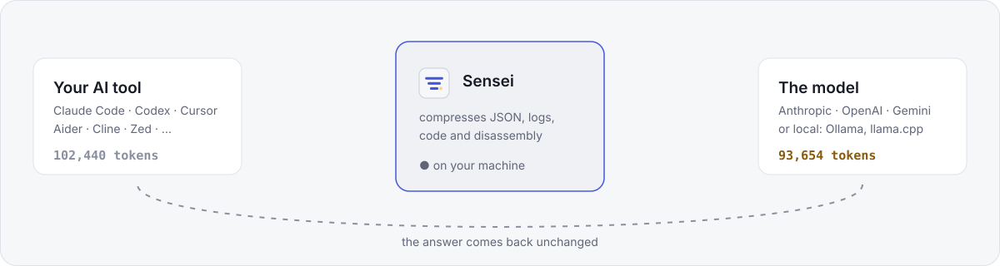
</picture>

**Nothing changes about how you work.** Same tools, same sign-in — subscriptions
included — same answers. Just a smaller bill.

---

## Install in one line

No Python needed. The installer downloads the binary for your machine, checks
it against the release's `SHA256SUMS`, and offers to start Sensei at login and
to connect the AI tools it finds.

```bash
# macOS / Linux
curl -fsSL https://raw.githubusercontent.com/SenseiIssei/Sensei/main/install.sh | sh
```

```powershell
# Windows — per-user, no administrator prompt
irm https://raw.githubusercontent.com/SenseiIssei/Sensei/main/install.ps1 | iex
```

Then open <http://localhost:7000/app/>. That's it.

<details>
<summary><b>Other ways in</b> — single files, pip, source, Docker</summary>

- **A single file**, from [the latest release](https://github.com/SenseiIssei/Sensei/releases/latest):
  `sensei-setup-*.exe` (Windows installer), `.dmg` (macOS), `.AppImage` /
  `.deb` / `.rpm` (Linux), or the bare binary in a `.tar.gz` / `.zip`.
- **pip**, from the release's wheel (Python 3.11+):
  `pipx install https://github.com/SenseiIssei/Sensei/releases/download/v0.2.0/sensei_gateway-0.2.0-py3-none-any.whl`
- **From source:** `git clone https://github.com/SenseiIssei/Sensei && cd Sensei && pip install -e "backend[mcp,tray]"`
- **Docker:** `docker compose up -d`, then open <http://localhost:7000/app/>.

The builds are not code-signed yet; the [release notes](https://github.com/SenseiIssei/Sensei/releases/latest)
explain the OS warnings and how to verify a download with `sha256sum` or Sigstore.

</details>

<details>
<summary><b>Connect your tools, start at login, stay current</b></summary>

```bash
sensei setup-tools      # route Claude Code, Codex, Cursor, … through Sensei
sensei setup-tools --undo
sensei wrap claude      # or: one tool, one terminal, no config at all
sensei autostart on     # start at login — Windows, macOS and Linux
sensei update           # install the latest release (checksum-verified)
sensei doctor --verify  # send a real request through and report what came back
```

`setup-tools` finds Claude Code, Claude Desktop, Codex, Cursor, Windsurf, Cline,
Roo, Kilo, Zed, Continue, Gemini CLI, opencode and Aider, shows exactly which
files it will touch, backs every one up, and `--undo` puts them all back. Each
tool keeps its own sign-in.

</details>

---

## See it

Calm on purpose: quiet surfaces, one accent colour, and gold only for the number
the page is about. Light and dark, following your system.

<div align="center">
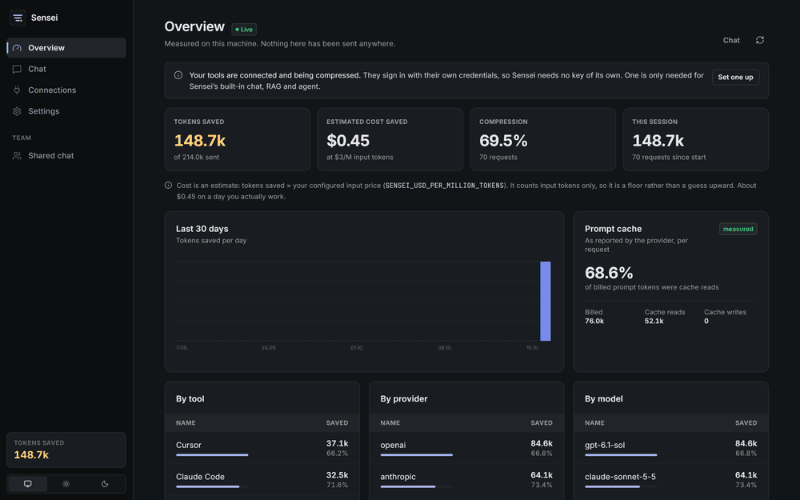
</div>

<details>
<summary><b>Full-size screenshots</b></summary>

<table>
<tr>
<td width="50%">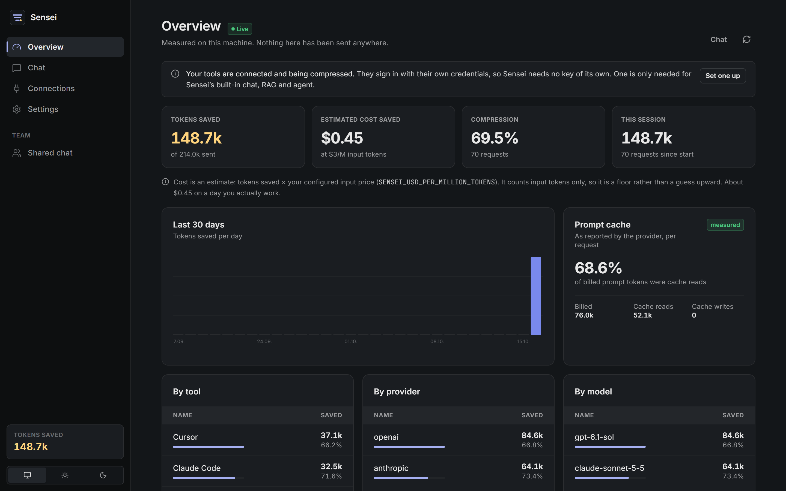</td>
<td width="50%">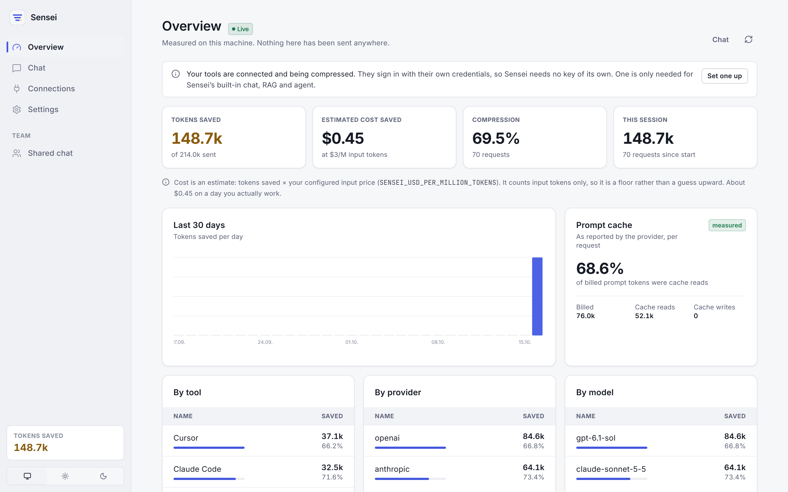</td>
</tr>
<tr>
<td>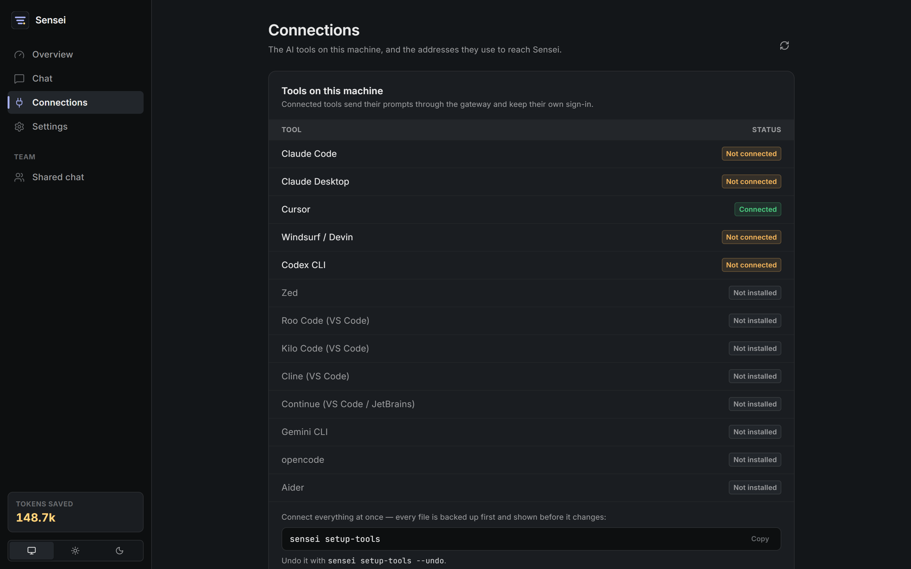</td>
<td>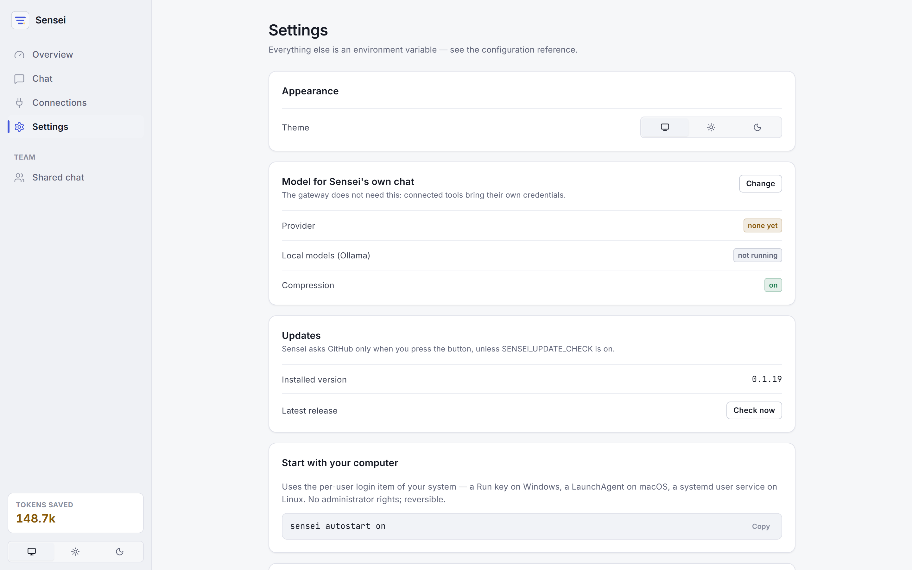</td>
</tr>
<tr>
<td>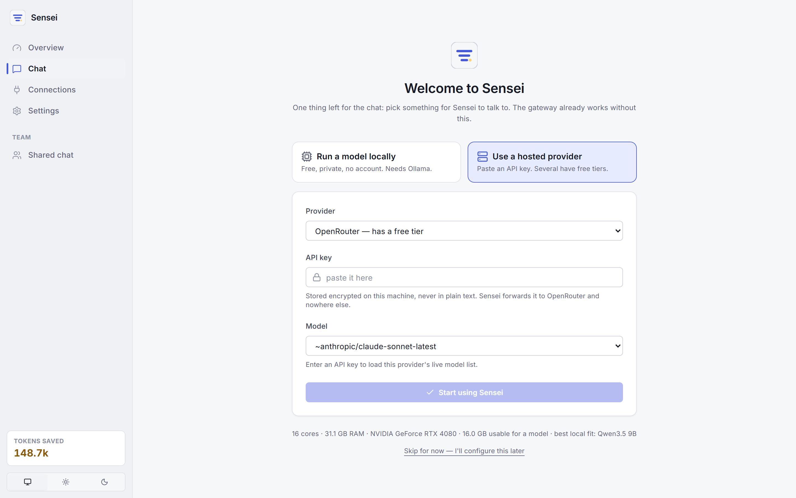</td>
<td align="center">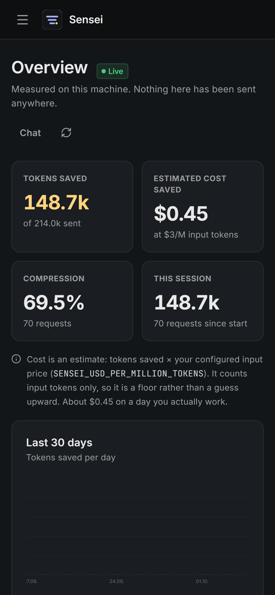</td>
</tr>
</table>

<sub>Real traffic through the gateway against a local stub provider — the
compression numbers are measured; see [how these were taken](docs/screenshots/README.md).</sub>

</details>

---

## How much smaller?

Measured on real agent sessions and on a seeded corpus of real-shaped tool
output, with one tokenizer and the same input for Sensei and for
[Headroom](https://github.com/headroomlabs-ai/headroom), the closest project to
it. Everything below is regenerated by one command; none of it is typed in by
hand.

<picture>
  <source media="(prefers-color-scheme: dark)" srcset="docs/assets/benchmark-dark.svg">
  
</picture>

<!-- bench:start -->
<!-- Generated by `python -m benchmarks.refresh` from backend/benchmarks/results/*.json. Do not edit by hand. -->

| Measured on | What it is | Sensei 0.2.0 |
|---|---|--:|
| Agent corpus | 32 seeded tool outputs: git, grep, tests, builds, listings, JSON, MCP, file reads | 8.6% |
| Headroom's scenarios | Its four published scenarios, rebuilt (it publishes 41%) | 0.0% |
| Agent corpus, in dollars | One session, cached, priced as `claude-opus-5-5` ([model](docs/benchmarks.md#cost-model)) | 5.1% |
| Facts kept | Every fact an agent needs must still be there | 69 / 74 |
| File reads unchanged | Read / `cat` output is edited next by exact match | 6 / 6 |
| Latency p50 · p95 | The compress call alone, per tool output | 0.3 · 141 ms |

<sub>tiktoken/cl100k_base on the text the model receives, identical input for both tools · corpus seed 20261016 (sha256 `70503a47eb5b`) · measured 2026-10-16 · regenerate with `cd backend && python -m benchmarks.refresh`</sub>

<details>
<summary><b>Per kind of tool output</b></summary>

| Tool output | Tokens | Sensei |
|---|--:|--:|
| grep / rg results | 7,149 | 2.0% |
| git log | 7,273 | 12.2% |
| git diff | 15,540 | 0.0% |
| git status | 388 | 11.9% |
| pytest output | 9,905 | 7.0% |
| npm / vitest output | 1,059 | -0.5% |
| cargo build | 1,032 | 8.0% |
| CI / docker build log | 2,968 | 43.9% |
| pip / npm install | 2,300 | 8.4% |
| ls / find / tree | 2,351 | 11.1% |
| kubectl tables | 1,743 | 17.6% |
| JSON API responses | 17,534 | 26.9% |
| MCP tool results | 18,018 | 0.0% |
| file reads (Read tool) | 6,282 | 0.0% |
| cat of source / config | 1,240 | 0.0% |
| web pages (WebFetch) | 699 | 0.7% |
| stack traces | 6,364 | 1.6% |
| prose docs | 595 | 9.6% |

</details>
<!-- bench:end -->

How to read it:

- **Real sessions** is the number to trust: every tool result from real Claude
  Code and Codex sessions, pushed through exactly the path the gateway uses.
  Only counts leave the machine — [run it on your own](docs/benchmarks.md#your-own-sessions).
- **The bill falls by less than the token count.** In a cached agent session
  most input is re-read prefix at a twentieth of the list price, output is
  untouched by input compression, and file reads must reach the model
  byte-exact because it edits them next. The [cost model](docs/benchmarks.md#cost-model)
  prices all of that.
- **Headroom's scenarios** are the four from Headroom's own published table,
  rebuilt here and run through both tools. Where Headroom is ahead, the table
  says so.
- **Facts kept** is a necessary condition, not a sufficient one: every fact an
  agent would need must still be literally present. The model-in-the-loop
  check is [optional and documented](docs/benchmarks.md#quality).

<picture>
  <source media="(prefers-color-scheme: dark)" srcset="docs/assets/headtohead-dark.svg">
  
</picture>

An earlier version of this README led with 79%. That came from six hand-written
samples; they are still checked nightly as a regression guard
(`compression_benchmark.py`), but they say nothing about a real bill.
[docs/benchmarks.md](docs/benchmarks.md) has the full methodology.

---

## What you get

<table>
<tr>
<td width="50%" valign="top">
<br>
<b>Compression before it's sent</b><br>
JSON becomes tables, logs are triaged, comments go, disassembly loses its byte
columns. Every original stays retrievable by id.
</td>
<td width="50%" valign="top">
<br>
<b>Works with the tools you have</b><br>
OpenAI Chat, OpenAI Responses (Codex) and Anthropic Messages, including
<code>count_tokens</code>. One command wires 13 tools; one undoes it.
</td>
</tr>
<tr>
<td valign="top">
<br>
<b>Stays on your machine</b><br>
Loopback only, zero telemetry, keys encrypted on disk, optional redaction of
secrets and PII before anything leaves.
</td>
<td valign="top">
<br>
<b>MCP server and proxy</b><br>
Many MCP servers behind two tools, results compressed and paged — made for
reverse-engineering servers with huge outputs.
</td>
</tr>
<tr>
<td valign="top">
<br>
<b>Honest numbers</b><br>
Savings measured per request, the provider's own prompt-cache hit rate beside
them, output shaping tested against a holdout.
</td>
<td valign="top">
<br>
<b>Every OS, hands-off</b><br>
One-line install, autostart, checksum-verified updates, a tray icon, retries
and an optional local-model fallback.
</td>
</tr>
</table>

---

## Why Sensei

| | Sensei | Typical gateway (LiteLLM, Portkey…) | Typical compressor |
|---|---|---|---|
| Compresses tool output before it is sent | ✅ JSON, logs, code, prose, disassembly | — | ✅ |
| Keeps agents' exact-match edits working | ✅ file reads stay byte-exact | n/a | rarely considered |
| Original always retrievable | ✅ by id, over MCP | — | sometimes |
| OpenAI Chat, **Responses** and Anthropic APIs | ✅ incl. `count_tokens`, `/compact` | ✅ | varies |
| Prompt-cache hit rate shown next to savings | ✅ | some | — |
| MCP proxy with compressed, paged results | ✅ | some proxy MCP, few compress | some reduce the tool list |
| Retries + local-model fallback | ✅ | ✅ | — |
| Wires up your installed tools, reversibly | ✅ 13 tools | — | some |
| Telemetry | **none, ever** | varies | varies |
| Price | **free, MIT, everything included** | free core, paid extras common | free core, paid extras common |

---

## What's new in 0.2

- **Codex works again** — Sensei now speaks OpenAI's Responses API, which is all
  Codex speaks since early 2026.
- **Agents' edits keep matching** — code they read from disk stays byte-exact,
  and the code compressor no longer mangles string literals.
- **Honest errors** — a rate limit arrives as a 429, not as a broken stream;
  retries and an optional local-model fallback handle the rest.
- **Prompt-cache accounting** — what the provider billed, next to what Sensei saved.
- **MCP proxy** and **disassembly compression** — see below.
- **One-command install, autostart and updates** on Windows, macOS and Linux.
- **A calm redesign**, light and dark.

Full list in the [changelog](CHANGELOG.md).

---

## MCP: Sensei as a server and as a proxy

If your tool speaks [MCP](https://modelcontextprotocol.io), Sensei plugs in
directly — no base URL to change:

```jsonc
{ "mcpServers": { "sensei": { "command": "sensei", "args": ["mcp"] } } }
```

The agent gets `sensei_compress`, `sensei_retrieve` and `sensei_stats`.

**And it can front your other MCP servers.** Every server an agent connects to
puts its whole tool list into the context on every turn. List them in
`~/.sensei/mcp-servers.json` instead — same format as Claude Desktop's — and the
agent sees two tools: `sensei_find_tools` (keyword search, schemas only for the
matches) and `sensei_call_tool`. Results come back compressed; long ones arrive
as a first page plus an id that `sensei_retrieve` pages through.

```json
{
  "mcpServers": {
    "rea":    { "command": "npx", "args": ["-y", "rea-agents", "mcp"] },
    "ghidra": { "url": "http://127.0.0.1:8089/mcp" }
  }
}
```

That makes Sensei a good companion for reverse-engineering servers like
[REA](https://github.com/morluto/rea) or GhidraMCP, whose disassembly listings
it shortens by about half. Use them on software you are entitled to analyse:
your own builds, binaries you have permission to inspect, malware samples in a
defensive lab, CTF challenges.

`sensei mcp --transport streamable-http --port 7001` serves MCP over HTTP.

---
## Your data stays yours

This matters more than the token savings, so it's worth being specific.

| | |
|---|---|
| 🔒 **Runs only on your machine** | Sensei listens on `127.0.0.1`. Nothing on your network can reach it unless you deliberately change that. |
| 🚫 **No telemetry, ever** | No analytics, no crash reporting, no "anonymous usage data". Not in any build, not behind any flag. |
| 📡 **No third-party requests** | The interface loads no fonts, scripts or trackers from anyone. This is checked automatically on every commit. |
| 💾 **The savings history is a local file** | `SENSEI_SAVINGS_PERSIST` writes counters and a model name per request to a SQLite file next to Sensei. No prompt text, no responses, and nothing leaves the machine. Delete the file, or turn it off. |
| 🔑 **Your key stays yours** | Sensei forwards your API key to the provider you chose and to nobody else. It's encrypted on disk, never written in plain text. |
| ✂️ **Secrets stripped** | Optionally, Sensei removes passwords, tokens and keys from prompts before they leave your computer. |
| 📴 **Works offline** | If the server isn't running, the interface still opens and tells you how to start it. |

---

---

## Common questions

<details>
<summary><b>Does this make the AI worse?</b></summary>

For logs and JSON — the bulk of what coding tools send — no. Sensei rewrites
that text into a denser form containing the same facts, rather than summarising
it. For prose it removes filler ("it is important to note that" → nothing),
which is the kind of text a model ignores anyway.

If the model ever does need the original, it can ask for it: Sensei keeps a
local copy of everything it compressed and hands it back on request.

</details>

<details>
<summary><b>Do I need to change my code or my tools?</b></summary>

No. `sensei wrap claude` sets one environment variable for that program and
launches it. Nothing is written to your shell profile, nothing is installed into
your tool, and closing it puts everything back.

</details>

<details>
<summary><b>Do I still need an API key?</b></summary>

Only if you want to use a hosted model. Sensei can run entirely on your own
computer with [Ollama](https://ollama.com) — `sensei models` tells you which
models actually fit in your memory.

</details>

<details>
<summary><b>Is it really free?</b></summary>

Yes. MIT licensed, no paid tier, no feature held back. See the
[principles](ROADMAP.md#principles).

</details>

<details>
<summary><b>What if I don't like it?</b></summary>

`sensei setup-tools --undo` and `sensei autostart off` first, then uninstall the
way you installed (Settings → Apps on Windows, delete the binary elsewhere).
Sensei's data lives in `~/.sensei`; delete it and nothing remains.

</details>

---
## 🤓 For the nerds

<details>
<summary><b>Architecture</b></summary>

Sensei is a FastAPI service that speaks the OpenAI Chat, OpenAI Responses and
Anthropic Messages wire formats, so anything with a configurable base URL
routes through it unchanged.

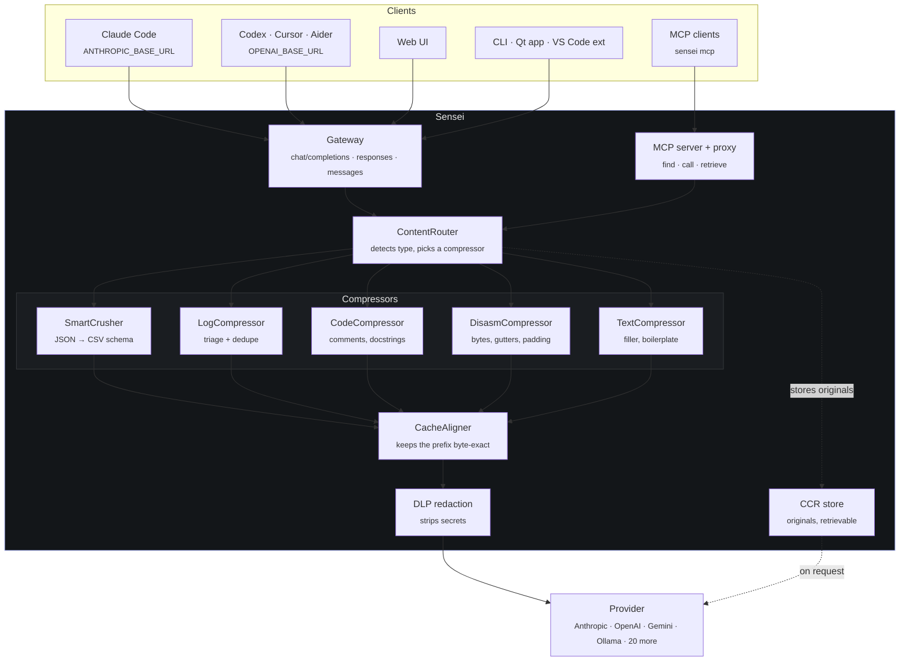

Compression is deterministic: the same prefix always becomes the same bytes, so
the provider's prompt cache keeps hitting turn after turn. The dashboard shows
the hit rate the provider reports, so that claim can be checked rather than
trusted.

Upstream errors keep their status and rate-limit headers; 429, 5xx and 529 are
retried before the first byte reaches the client, and with
`SENSEI_FALLBACK_ENABLED` a local model (Ollama, llama.cpp, LM Studio, vLLM)
answers when the provider stays down — marked with `X-Sensei-Fallback`.

</details>

<details>
<summary><b>How each compressor works</b></summary>

**SmartCrusher — JSON.** An array of objects with the same keys repeats every key
name on every element. It's rewritten as a header plus rows, which is what a CSV
is, and drops redundant link/self/href keys. Lossless.

```
[{"id":1,"name":"a","url":"…"},{"id":2,"name":"b","url":"…"}, …20 more]
  ↓
id|name|url
1|a|…
2|b|…
```

**LogCompressor — build and test output.** Keeps the head, the tail, every line
matching an error/warning/summary pattern, and a few lines of context after each.
Identical lines are collapsed after normalising timestamps, hex addresses and
UUIDs, so a thousand near-identical worker lines become one with a count.

**CodeCompressor — source.** Strips comments, docstrings, blank lines and
trailing whitespace with a linear, string-aware scanner: `"#16a34a"` and
`"https://…"` inside literals are data and survive. Code that reaches the model
as a *tool result* — a file an agent may edit next by exact string match — is
left byte-exact unless `SENSEI_CODE_COMPRESSION=aggressive`.

**DisasmCompressor — objdump, GDB, radare2, Ghidra, IDA.** Drops the opcode-byte
column, flow-arrow gutters and runs of padding instructions; keeps every
address, mnemonic, operand and label. 42–56% on typical listings.

**TextCompressor — prose.** Phrase substitution ("in order to" → "to"), filler
removal, boilerplate sentence stripping, and line-level dedupe.

**CCR — reversible compression.** Every original is written to a local cache
keyed by id. If the model decides it needs the untouched text, it asks for it by
id and gets it back. Compression is therefore never destructive in practice.

</details>

<details>
<summary><b>MCP server, in detail</b></summary>

`sensei mcp` speaks the Model Context Protocol over stdio, which covers the
tools that don't let you redirect a base URL — and the case where an agent wants
to compress one specific blob rather than route its whole conversation.

| Tool | What it does |
|---|---|
| `sensei_compress` | Compress text. Returns the compressed form, a `ccr_id`, the token counts and the percentage saved. Optionally force a compressor with `content_type`. |
| `sensei_retrieve` | Exchange a `ccr_id` for the byte-identical original. |
| `sensei_stats` | Totals saved, plus CCR cache state. |

`sensei_retrieve` is what makes this safe rather than lossy-by-default.
Compression is never a one-way door: if the model decides the compressed form is
missing something, it asks for the original instead of guessing. The server's
instructions tell the client exactly that, because a capability a model doesn't
know about might as well not exist.

Verified end to end against a real MCP client — 582 → 287 tokens on a 40-record
JSON array, original recovered byte-identical.

```bash
sensei mcp            # stdio; normally your client spawns this, not you
```

The release binaries include the MCP SDK; from a checkout, install it with
`pip install -e "backend[mcp]"`.

</details>

<details>
<summary><b>Performance</b></summary>

Compression sits on the hot path of every request, so its own cost matters.
Measured on an 86 kB agent turn — system prompt, exchanges, a large JSON tool
result, build logs and source:

| | before optimisation | after |
|---|---|---|
| median | 8.14 ms | **4.68 ms** |
| p95 | 12.53 ms | **6.31 ms** |
| cold start | 9.34 ms | 6.91 ms |

What that took: compiling the detector patterns once instead of per line,
bounding the type-detection scan to the sample it actually reads instead of
splitting the whole payload, and removing ~11,000 `re` cache lookups per request.

An optional Rust accelerator (`sensei_core`, PyO3, abi3) makes the JSON hot path
roughly twice as fast again. CI builds the wheel and re-runs the entire test
suite against it on every commit, so "byte-identical to the Python path" is
verified rather than asserted.

</details>

<details>
<summary><b>Reproducing the numbers</b></summary>

```bash
cd backend
python -m benchmarks.headroom_env            # optional: Headroom in a throwaway venv
python -m benchmarks.refresh --sessions      # measure, redraw the graphics, rewrite the table
```

`refresh` runs the seeded agent corpus through Sensei (and Headroom, if its
venv exists), optionally replays your own Claude Code and Codex sessions, and
regenerates the SVGs and the table above from the results files in
`backend/benchmarks/results/`. Real `tiktoken` (`cl100k_base`) counts on the text
the model receives, the same input for both tools, latency p50/p95 of the
compress call alone, and a cost model net of prompt caching. Methodology,
privacy and limits: [docs/benchmarks.md](docs/benchmarks.md).

Nightly CI re-measures the corpus and fails when savings drop by more than a
point, when a fact that used to survive is lost, or when a file read stops
being byte-exact. Every run is published: **[the nightly trend](https://senseiissei.github.io/Sensei/)**
keeps one row per night, so the numbers are a line you can look at rather than
a claim in a README.

</details>

<details>
<summary><b>Characters you pay for and cannot see</b></summary>

A zero-width space is one token. So is a byte-order mark, a word joiner, a soft
hyphen. They arrive by the hundred when code is pasted out of a rendered web
page, a wiki or a chat window, and no line-oriented compressor notices them.

```console
$ python backend/benchmarks/invisible_benchmark.py

sample                                      pasted   clean   waste  removed  seen
-------------------------------------------------------------------------------
code pasted from a rendered page               550     400     38%       75     0
code with a stray BOM per block                425     400      6%       25     0
markdown out of a wiki                         336     336      0%        0    60
source carrying a Trojan Source override       600     500     20%       50     0
-------------------------------------------------------------------------------
AGGREGATE                                     1911    1636     17%
```

Sensei removes them before counting, so the saving is already in the headline
number. Nightly enforces a floor, because a stripper that stops stripping shows
up as a quietly larger bill rather than as a failure.

**It also removes bidi overrides and isolates** — the
[Trojan Source](https://trojansource.codes) vector (CVE-2021-42574), where
source renders in one order and compiles in another, so a reviewer reads
`if (isAdmin)` where the compiler reads the opposite. A gateway every prompt
already passes through is the right place to catch that.

**Restraint is the part worth reading.** The three-line version of this feature
corrupts real text:

| | |
|---|---|
| **Zero-width joiners** | Structural in Devanagari, Persian and Arabic, and what holds 👨‍👩‍👧 together as one family. Removed only from content detected as *code*, where they cannot mean anything. |
| **Directional marks** (LRM, RLM) | Ordinary punctuation in Hebrew and Arabic prose. Kept. Only the *overrides* go. |
| **Non-breaking spaces** | Deliberate in typeset prose. Counted, never rewritten, unless you set `SENSEI_STRIP_NBSP=true` — and then to a space, not to nothing. |
| **Homoglyphs** | `раssword` with a Cyrillic `а` is a different identifier than it looks. Logged, never silently corrected: "almost always an attack" is not a licence to edit your text. |

The untouched original stays in the CCR store, byte-identical, retrievable by
id — `SENSEI_STRIP_INVISIBLE=false` turns the whole thing off.

</details>

<details>
<summary><b>Shorter answers, and how we know</b></summary>

Compression only touches what goes *up*. Output tokens cost roughly 4-5× input
tokens, so the other half of the bill was untouched until now.

```bash
SENSEI_OUTPUT_SHAPER=true sensei up
```

This appends a short instruction asking for answers without preamble, restated
questions or closing offers of further help. It goes on the **last user
message**, never the system prompt — the system prompt is the cached prefix, and
appending to it would invalidate the provider's cache on every request and cost
more in latency than the shaping saves.

**It ships with a holdout, and that is the point.** An intervention that changes
model behaviour cannot be measured by switching it on and reading the number:
the number moves for a dozen other reasons. So `SENSEI_OUTPUT_HOLDOUT` (default
10%) leaves a fraction of requests unshaped, and `sensei stats` compares the two
groups:

```console
Output shaping

  Shaped        360 requests,   281.4 tokens/answer on average
  Control        40 requests,   402.7 tokens/answer on average

  95% confident the change is between 22.5% and 37.5%
  Best estimate: 30.1% (121.3 tokens/answer)
  Verdict: shorter answers
```

Until both groups have enough samples it says **"not enough data yet"** and
reports no percentage at all. A confident-looking figure computed from eleven
requests is worse than no figure, because that is the one that gets quoted.

Off by default: it changes what the model writes, which is your call. Streaming
replies are excluded — they carry no usage block, and reconstructing one would
mean parsing the stream on the hot path.

</details>

<details>
<summary><b>Does it keep what the model needs?</b></summary>

A different question from "does it get smaller", and until recently only the
second one was checked anywhere here.

```bash
python backend/benchmarks/quality_eval.py
python backend/benchmarks/quality_eval.py --model llama3.1 --base-url http://localhost:11434/v1
```

Each corpus entry is paired with the facts an agent would have to extract from
it — the error location in a build log, the failing frame in a stack trace,
specific ids and values in JSON, a function signature in source. All of them
must still be literally present after compression. Nightly runs it with a floor
of **100%**, because unlike a savings percentage a lost fact is never jitter.
The same check runs over the seeded agent corpus — commit subjects in `git log`,
the failing node id in `pytest`, the one pod in `CrashLoopBackOff` — where any
fact lost today is counted in the table above and any *newly* lost fact fails
the nightly build.

Be clear about the claim: this is a **necessary condition, not a sufficient
one.** If a fact is gone the model provably cannot answer; if every fact
survives the model *can* answer, but this does not prove it *will*. The
sufficient version needs a model in the loop — `--model` does that, asking every
question twice, against the original and against the compressed payload, so a
wrong answer counts against compression only when the original was answered
right. It is deliberately not part of the nightly gate, because a gate that
needs a funded API key is a gate somebody eventually switches off.

Writing this eval immediately found two real defects: `LogCompressor.FRAME`
contained `File ", "` where `File "` was meant, so no Python traceback frame
ever matched and the innermost frames — the ones that say what actually broke —
were being elided. And build output with no timestamps and no log levels was
being classified as prose, which both compressed it 3% instead of 91% and threw
away the compiler's `file:line:col`.

</details>

<details>
<summary><b>Security model</b></summary>

Sensei assumes the machine it runs on is trusted and that anyone who can reach
the port is authorised. Everything else follows from that:

- Binds to `127.0.0.1`. Exposing it is a deliberate act, and `sensei doctor`
  reports it as a failure if you do it without enabling auth.
- API keys live in an encrypted vault (AES-256-GCM), not in `.env`.
- Optional DLP redaction strips API keys, tokens, private keys, JWTs and
  optionally PII from prompts before they leave the machine.
- Optional per-user auth, JWT sessions, OIDC SSO, and RBAC on admin endpoints.
- `run_python` is off by default. When enabled it is a subprocess with a
  timeout, not a container — the docs say so plainly.

Full scope and reporting process: [SECURITY.md](SECURITY.md).

</details>

<details>
<summary><b>Repository layout</b></summary>

```
backend/          FastAPI service, compression pipeline, CLI, tests
  sensei/
    compression/  SmartCrusher, LogCompressor, CodeCompressor, DisasmCompressor,
                  TextCompressor, CacheAligner, CCR, ContentRouter
    routers/      gateway, chat, RAG, agent, settings, setup, stats, …
    security/     auth, crypto, vault, redaction, RBAC, OIDC, sessions
    integrations  writes Sensei into other tools' config files, reversibly
    savings.py    in-memory totals + the local SQLite savings ledger
    usage.py      what the provider billed, incl. prompt-cache reads
    mcp_server.py MCP tools; mcp_proxy.py fronts other MCP servers
    cli/          up · tray · wrap · setup-tools · doctor · models · stats ·
                  autostart · update · mcp · chat
  benchmarks/     seeded agent corpus, session replay, Headroom head-to-head
frontend/         React 19 + Tailwind 4 + Vite 8, PWA, light and dark
rust/sensei_core/ optional PyO3 accelerator
extensions/vscode VS Code extension
training/         Sensei-Compressor fine-tuning scaffold
deploy/           nginx · Caddy · Traefik · systemd
packaging/        PyInstaller spec, Windows installer, icons
install.sh/.ps1   the one-command installers
docs/             configuration reference (generated), the plan
```

</details>

<details>
<summary><b>What CI actually enforces</b></summary>

Every action is pinned to a commit SHA. On each pull request:

- backend tests across **{Linux, macOS, Windows} × Python {3.11, 3.12, 3.13, 3.14}**
- **the one-command installers run for real** on all three, against a published
  release, and the Windows installer script compiled
- `ruff` lint and format, with the rule set pinned so a new ruff release can't
  fail an unrelated PR
- the Rust accelerator built and the **whole suite re-run against it** to prove
  byte-parity
- Playwright on three operating systems
- a 450 kB JavaScript budget
- the config reference regenerated from the pydantic model and compared
- the built UI checked for third-party origins, and for root-absolute asset
  URLs that would blank the page when mounted under `/app/`
- Docker image built and `/health` smoke-tested
- pip-audit, npm audit, cargo audit, CodeQL, gitleaks, Trivy, SBOM, Scorecard

Nightly: the agent-corpus benchmark checked against the committed results
(savings, facts and byte-exact file reads), **fact retention at a floor of
100%**, the README table and graphics checked against the results they claim, Rust/Python output diffed for parity, the suite against
eagerly-upgraded dependencies, and the results appended to the
[public trend](https://senseiissei.github.io/Sensei/).

</details>

---

## Standing on other people's shoulders

Sensei didn't invent any of this. Two projects did the hard thinking, and both
are worth your time independently of whether you ever use Sensei:

### 🪶 [Headroom](https://github.com/headroomlabs-ai/headroom) · Apache-2.0

**The reason this project exists.** Headroom worked out that the way to cut an
agent's token bill isn't to summarise its context — it's to notice that most of
what agents send is *structurally* redundant, and restructure it losslessly.
Tabular JSON compaction, log triage, cache-aligned prefixes, and reversible
compression with a retrieval tool are all Headroom's ideas.

If you want context compression as a mature, standalone product with a much
larger surface than Sensei's — output-token shaping, a learned prose compressor,
LangChain and LiteLLM adapters, agent wrapping for a dozen tools — **go use
Headroom.** It's excellent, and it's further along than this — on structured
JSON tool results measurably so; [the head-to-head](#how-much-smaller) shows
where.

Sensei's angle is different: compression as one part of a self-hosted workspace
you own end to end, MIT-licensed, that also gives you a chat UI, RAG, an agent
and a desktop app.

### 🏛️ [Odysseus](https://github.com/pewdiepie-archdaemon/odysseus) · AGPL-3.0

**The shape of the thing.** Odysseus — by Felix Kjellberg — made the case that a
self-hosted AI workspace should feel like a finished product rather than a pile
of scripts: hardware-aware model recommendations, a real editor, agents, memory,
and security defaults that assume you'll actually deploy it. The "what can my
machine actually run?" idea behind `sensei models` is straight from its Cookbook.

Sensei is a **clean-room implementation** — no Odysseus code is copied, which is
what lets it stay MIT instead of inheriting AGPL. If you want the full workspace
with email, calendar, documents and image editing, **Odysseus is the more
complete answer.**

> Neither project endorses this one. Any bugs here are ours.

### 🔍 [REA](https://github.com/morluto/rea) · MIT

**The reverse-engineering angle.** REA showed how far an agent gets on software
without source when the tools hand it the right views — and that oversized
results should come back as a reference to page through, not as a wall of text.
Sensei's paged MCP results and its disassembly compressor follow that idea; the
MCP proxy is meant to sit in front of servers like it.

---

---

## Contributing

Issues and PRs welcome — [CONTRIBUTING.md](CONTRIBUTING.md) has the setup, and
[docs/ROADMAP-NEXT.md](docs/ROADMAP-NEXT.md) is the queue: what's planned, in
what order, and why.

<div align="center">
<sub>MIT · built by <a href="https://github.com/SenseiIssei">@SenseiIssei</a></sub>
</div>
